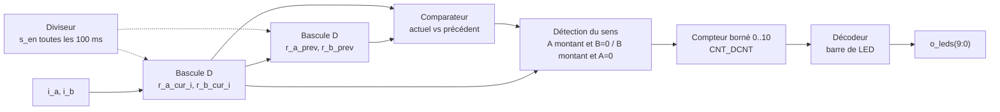

# 2627 – 2A FPGA : comptes rendus de TP

**Outils :** Quartus Prime Lite 24.1 , ModelSim (simulation), VHDL , carte DE10-Nano (FPGA Cyclone V `5CSEBA6U23I7`) + carte mezzanine (LED, encodeurs, sortie HDMI)

## Conventions de codage

- `i_` pour les entrées, `o_` pour les sorties, `r_` pour les registres, `s_` pour les signaux internes.
- `_n` en suffixe pour un signal actif à l'état bas (`i_rst_n`).
- Un signal de reset sur chaque registre.

## Sommaire

- [TP1 – Prise en main : LED, clignotement et chenillard](#tp1--prise-en-main--led-clignotement-et-chenillard)
- [TP2 – Gestion des encodeurs](#tp2--gestion-des-encodeurs)
- [TP3 – Contrôleur HDMI](#tp3--contrôleur-hdmi)

---

## TP1 – Prise en main : LED, clignotement et chenillard

### Objectifs

- Prendre en main la chaîne Quartus : création de projet, choix du FPGA, affectation des broches (Pin Planner), compilation. 
- Concevoir un **chenillard** sur les 10 LED de la carte.

### 1.1 Prise en main de Quartus

Le nom de l'entité du fichier VHDL de plus haut niveau doit être identique au nom du projet : c'est pourquoi toutes les entités de ce TP s'appellent `tuto_fpga`.

Un premier composant combinatoire (`led0 <= pushl`) a servi à valider toute la chaîne. Le bouton étant actif à l'état bas, le comportement obtenu est inversé par rapport à ce qui est attendu (LED allumée par défaut) : il suffit d'inverser le signal dans le VHDL, de recompiler et de reprogrammer.

Les broches ont été affectées à la main dans le Pin Planner, car Quartus ne les connaît pas (par exemple `LED0 = PIN_AG28`, `KEY0 = AH17` pour le reset, l'horloge `FPGA_CLK1_50` étant donnée par le User Manual de la carte).

### 1.2 Faire clignoter une LED — `blink_led.vhd`

**Principe.** L'horloge `i_clk` est à 50 MHz : en basculant la LED à chaque front, elle clignoterait à 25 MHz, donc invisible. On ajoute un compteur pour ralentir.

**Architecture.**

| Signal | Sens | Rôle |
|---|---|---|
| `i_clk` | entrée | horloge 50 MHz |
| `i_rst_n` | entrée | reset asynchrone, actif à l'état bas (`KEY0`) |
| `o_led` | sortie | LED qui clignote |
| `r_led` | registre | état de la LED |
| `counter` | variable (0 à 50 000 000) | compte les périodes d'horloge |

**Fonctionnement.**

- À chaque front montant, `counter` s'incrémente.
- Quand `counter = 25 000 000` (0,5 s), `r_led` passe à `'1'`.
- Quand `counter = 50 000 000` (1 s), `counter` repasse à 0 et `r_led` à `'0'`.

La LED est donc éteinte 0,5 s puis allumée 0,5 s : clignotement à 1 Hz, rapport cyclique 50 %.

Question du sujet : que signifie `_n` dans `i_rst_n` ? Le suffixe `_n` indique un signal actif à l'état bas : le reset est appliqué quand `i_rst_n = '0'`. Au repos (bouton relâché) le signal vaut `'1'`.

### 1.3 Chenillard, version 1 — `chenillard_v1.vhd`

**Principe.** Un compteur de 0 à 100 000 000 cycles (2 s à 50 MHz) est découpé en **11 positions** : 10 LED allumées chacune à leur tour, plus un état « tout éteint ». Chaque LED est allumée à une valeur précise du compteur.

| Valeur du compteur | Cycles écoulés | LED allumée |
|---|---|---|
| 10 000 000 | 0,20 s | LED9 |
| 19 000 000 | 0,38 s | LED8 |
| 28 000 000 | 0,56 s | LED7 |
| … | +0,18 s à chaque pas | … |
| 91 000 000 | 1,82 s | LED0 |
| 100 000 000 | 2,00 s | toutes éteintes, retour à 0 |

Chaque LED reste allumée 9 000 000 cycles, soit 0,18 s (≈ 2/11 s), et le motif complet dure 2 s. Dans le code, le motif se déplace de la LED9 vers la LED0.

**Limites.**

- Il faut 10 comparaisons avec des constantes différentes sur un compteur de 27 bits : beaucoup de logique pour un motif très régulier.
- Changer la vitesse ou le nombre de LED oblige à recalculer toutes les constantes à la main.

### 1.4 Chenillard, version 2 — `chenillard_v2.vhd`

**Principe.** Au lieu de tester 10 valeurs, on conserve un motif de base (`0000000001`) dans le registre `r_led` et on le décale d'un cran à intervalle régulier.

- Un compteur (0 à 10 000 000) génère une impulsion tous les 10 000 000 cycles, soit 0,2 s.
- À chaque impulsion : `r_led(9 downto 1) <= r_led(8 downto 0)` et `r_led(0) <= r_led(9)`. C'est un décalage circulaire, le bit qui sort d'un côté rentre de l'autre.
- Au reset, le motif revient à `0000000001`.

Le motif se déplace de la LED0 vers la LED9 et revient en LED0 : une période complète dure 10 × 0,2 s = **2 s**.

### 1.5 Comparaison des deux versions

| | Version 1 | Version 2 |
|---|---|---|
| Mécanisme | 10 comparaisons à des valeurs fixes | décalage circulaire d'un registre |
| Compteur | 0 → 100 000 000 (27 bits) | 0 → 10 000 000 (24 bits) |
| Pas | 9 000 000 cycles (0,18 s) | 10 000 000 cycles (0,2 s) |
| Période | 2 s | 2 s |
| Sens | LED9 → LED0 | LED0 → LED9 |
| État initial | tout éteint | LED0 allumée |
| Adaptabilité | constantes à recalculer | modifier uniquement la valeur du compteur |

**Conclusion du TP1.** La version 2 est plus courte, plus lisible et consomme moins de logique. Pour un nouveau motif, il suffit de changer la valeur initiale du registre ; pour une nouvelle vitesse, la seule constante du compteur.

---

## TP2 – Gestion des encodeurs

*Première partie du projet « écran magique » (télécran numérique sur sortie HDMI).*

### Objectif

Mettre l'affichage de côté et se concentrer sur les encodeurs rotatifs: détecter le sens de rotation à partir des deux signaux en quadrature A et B, puis incrémenter ou décrémenter une valeur affichée sur les LED.

### Principe de détection des fronts

Un front se détecte en comparant la valeur actuelle d'un signal à sa valeur précédente, mémorisée dans une seconde bascule D :

| Précédent | Actuel | Interprétation |
|---|---|---|
| 0 | 0 | stable |
| 1 | 1 | stable |
| 0 | 1 | **front montant** |
| 1 | 0 | **front descendant** |

Les deux voies A et B sont traitées de la même façon. Le sens de rotation se déduit ensuite de la voie qui bouge en premier : front montant de A avec B à 0 pour un sens, front montant de B avec A à 0 pour l'autre.

### Architecture — `encoder.vhd`

**Blocs.**

1. **Diviseur d'horloge.** Compte `C_DIV = (G_FCLK_HZ / 1000) × G_PERIODE_MS` = 5 000 000 cycles et génère l'impulsion `s_en` toutes les 100 ms. Les entrées ne sont donc échantillonnées que sur cette impulsion, ce qui filtre aussi les rebonds mécaniques de l'encodeur.
2. **Première bascule D** (`r_a_cur_i`, `r_b_cur_i`) : mémorise A et B à chaque `s_en`.
3. **Seconde bascule D** (`r_a_prev`, `r_b_prev`) : mémorise la valeur précédente.
4. **Comparateur** (combinatoire) : produit, pour chaque voie, `stable`, `rising` et `falling` à partir de la valeur actuelle et de la précédente.
5. **Détection du sens** :
   - `clockwise = s_a_rising_i and not r_b_cur_i`
   - `cntclockwise = s_b_rising_i and not r_a_cur_i`
6. **Compteur `CNT_DCNT`** (0 à 10, saturé aux deux bornes), mis à jour à chaque `s_en` : +1 sur `cntclockwise`, −1 sur `clockwise`.
7. **Affichage** : un décodeur transforme `CNT_DCNT` en **barre de LED** (n LED allumées pour une valeur n, de `0000000000` à `1111111111`).

**Sorties de debug.** `r_a_cur`, `r_b_cur`, `s_a_rising/stable/falling` et `s_b_rising/stable/falling` sont remontées en sortie pour être observées en simulation.

### Test sur la carte
Effectif 

---

## TP3 – Contrôleur HDMI

*Deuxième partie du projet « écran magique » : générer les signaux de synchronisation d'un affichage 480p.*

### Objectif

Mettre en œuvre le contrôleur HDMI conçu en TD : un composant `hdmi_controler` qui génère les signaux de synchronisation (`hs`, `vs`, `de`) et les coordonnées du pixel courant. 

